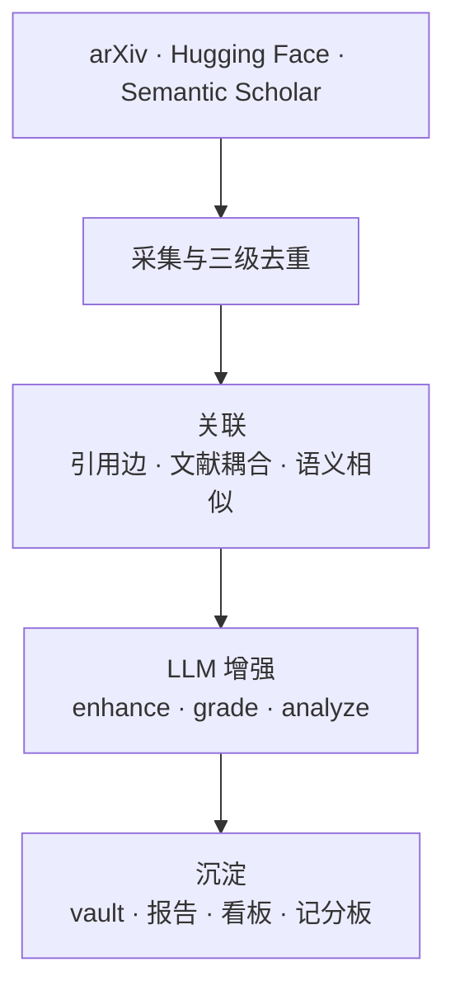

# AI Scholar

[](https://github.com/tochikoma777/ai-scholar/actions/workflows/ci.yml)
[](https://www.python.org/downloads/)
[](LICENSE)
[](https://tochikoma777.github.io/ai-scholar/)
[](https://github.com/tochikoma777/ai-scholar/stargazers)
[](https://github.com/tochikoma777/ai-scholar/commits/main)
[](https://github.com/tochikoma777/ai-scholar/issues)
[](https://github.com/tochikoma777/ai-scholar/pulls)

每天几百篇新论文。收藏不等于读过，链接不等于资产。

AI Scholar 做的是第三件事：采集 → 关联 → 推演 → 沉淀，把论文收成一份可被 AI 直接复用的 Obsidian 知识库。
它关心的从来不是收了多少篇，而是导出物能不能直接喂给别的工具——所以产物是合成文档
（元信息 + 为什么重要 + 我的笔记），不是条目列表。没看完的东西，以后还能用。

在线看板 https://tochikoma777.github.io/ai-scholar/ · 许可证 MIT · 姊妹项目 [aipulse](https://github.com/tochikoma777/aipulse)

## 目录

[它做什么](#它做什么) · [快速开始](#快速开始) · [命令](#命令) · [典型用法](#典型用法) ·
[配置](#配置) · [自动化与成本](#自动化与成本) · [边界与署名](#边界与署名) ·
[开发](#开发) · [路线图](#路线图)

---

## 它做什么



采集和关联不花钱，沉淀也不花钱。LLM 只用在三个环节：一句话增强、文献定级、深度分析。
推演和验证全程零 LLM，判断可证伪、到期自动核对。

它产出这些：

| 产物 | 落点 | 公开 |
|---|---|---|
| Obsidian 知识库 | 独立 private vault | 否 |
| 每日报告 | `data/reports/daily/YYYY/MM/` | 是 |
| 静态看板 | 单文件 HTML，GitHub Pages 发布 | 是 |
| 深度分析 | `data/analyses/YYYY/MM/` | 是 |
| 推演记分板 | `data/predictions/scoreboard.jsonl` | 是 |

---

## 快速开始

需要 Python 3.11+ 和 [uv](https://docs.astral.sh/uv/)。没有 LLM key 也能跑完整条链路，
缺 key 会自动降级到 `off` 档，其余功能一个不少。

```bash
git clone https://github.com/tochikoma777/ai-scholar.git
cd ai-scholar
uv sync
uv run ai-scholar init
uv run ai-scholar doctor
uv run ai-scholar collect --days 2
uv run ai-scholar mark arXiv:2610.30122
uv run ai-scholar export
```

`export` 默认只导出 `mark` 过的论文。想启用 LLM，在 `.env` 里写：

```bash
AI_SCHOLAR_LLM__BASE_URL=https://api.deepseek.com
AI_SCHOLAR_LLM__API_KEY=sk-...
```

档位三选一：`off` 零花费，`fast` 用 `deepseek-flash`，`strong` 追加深度分析（默认也是 flash，
可用 `AI_SCHOLAR_LLM__STRONG_MODEL=deepseek-v4-pro` 切回推理档做 A/B）。

---

## 命令

`uv run ai-scholar --help` 看完整参数。常用命令：

| 命令 | 作用 |
|---|---|
| `collect [--days N]` / `collect --classics` | 采集 / 经典清单 |
| `enrich` · `signals` · `relate` | 引用补齐 / 时序采样 / 关联计算 |
| `enhance` · `grade` · `analyze` | 增强 / 定级 / 深度分析 |
| `predict` · `stats` | 推演生成 / 到期验证 |
| `mark` · `want` · `export` | 收藏 / 点读 / 导出 vault |
| `site` · `report` | 看板 / 报告（日报、周报、月报） |
| `list` · `related` · `cost` | 查阅 / 关联 / 查账 |
| `init` · `doctor` | 初始化 / 环境体检 |

---

## 典型用法

**每天早上**

Actions 跑完后，看一眼结果，把新收藏的论文物化进 vault：

```bash
gh run list --workflow=daily.yml --limit 3
uv run ai-scholar cost --days 7
uv run ai-scholar export
```

**圈定方向**

在 `config/watchlist.local.yaml` 里写自己的关键词组，同名组整组覆盖默认配置。
命中的论文会被打星、参与排序，并触发深度分析候选；它不决定论文是否入库。

**点读一篇**

报告里的「想读」是一行可复制命令，本地跑即可，下次 `export` 自动出笔记：

```bash
uv run ai-scholar want arXiv:2610.32770
```

**深度分析**

strong 档最贵的操作，每天 1 篇、每周 5 篇。自动跑只分析 watchlist 命中或 Tier 1 的论文。
手工指定不受此限：

```bash
uv run ai-scholar analyze --ids arXiv:2610.30132
```

产物是三句半 + 六段结构 + 背景透镜五问。历史地位一段是条件式输出，没有施引数据就写「待观察」，
不会让模型编造影响力。

---

## 配置

配置只在 `config/*.yaml` 和 `.env` 里，代码不硬编码阈值。关键项：

| 项 | 默认 | 说明 |
|---|---|---|
| `mode` | `fast` | `off` / `fast` / `strong`；缺 key 自动降级 `off` |
| `budget.*_limit_cny` | 2 / 10 / 40 / 200 | 日 / 周 / 月 / 年四层闸门，只降级不报错 |
| `sources.arxiv.lookback_days` | 7 | arXiv 索引滞后数天，只看当天会漏采 |
| `grade.default_limit` | 8 | 每天定级篇数，直接决定年成本 |
| `deep_analysis.daily_limit` | 1 | 削峰，避免单日花掉整周额度 |
| `deep_analysis.weekly_limit` | 5 | 每周深度分析上限，不降单篇质量 |

---

## 自动化与成本

`daily.yml` 每天 UTC 16:30（北京 00:30）跑完整链路，末尾把 public 真源提交回仓库，
并构建站点发布到 GitHub Pages。`recap.yml` 每周一和每月 1 号重算周报、月报，零 LLM、不读 db。
两条链共用并发组，避免同时 push 互相覆盖。

| 档位 | 行为 | 成本 |
|---|---|---|
| `off` | 跳过所有 LLM 环节 | ¥0 |
| `fast` | 增强 + 定级 | 见下 |
| `strong` | 追加深度分析 | 见下 |

稳态实测约 ¥0.14/天（¥52/年，旧价口径）。2026-11-12 起单价改为官方空闲价 × 1.2，
按新价约 ¥55–290/年；四层预算闸门在调用前拦截，不会超支。
`uv run ai-scholar cost` 可随时查账，异常只标注不中断。改价格或预算前先读 `docs/成本预算.md`。

---

## 边界与署名

只覆盖英文源（arXiv、Hugging Face Daily Papers、Semantic Scholar），不采集中文社区源。
论文正文永不入库，只在临时目录抓取、抓完即弃。不输出单一综合评分，客观信号和模型判断分列。
导出默认只选收藏的论文，默认上限 20 篇——全量导出会让 Obsidian 不可用。
vault 是独立 private 仓库，与本项目物理隔离；用 git 管理就不要再叠加 Obsidian Sync 或 iCloud。

数据来源与署名：

- arXiv：`export.arxiv.org/api/query`，公开 API，无需认证，论文元数据版权归各自作者。
- Hugging Face Daily Papers：`huggingface.co/api/daily_papers`，公开只读 API。
- Semantic Scholar：`api.semanticscholar.org`，用于引用与施引数据。MIT 只管代码不管数据，
  公开展示其数据时必须署名：

  > Data provided by Semantic Scholar (Allen Institute for AI), used under its
  > [API Terms of Use](https://www.semanticscholar.org/product/api).

public 产物引用原文每条不超过 100 词、全篇合计不超过 300 词，完整署名且不改动引文。
图表一律不复制，改为自己重画并注明出处。实验数字是事实，可自由复述。

---

## 开发

```bash
uv run pytest -m "not live"          # 离线全量；联网冒烟单独标记
uv run ruff check . && uv run ruff format --check .
uv run mypy src/ai_scholar
uv run python scripts/probe_sources.py
```

联网冒烟拿不到真实响应就跳过，绝不伪造 fixtures。数据源的真实响应摘录见
[`docs/数据源手册.md`](docs/数据源手册.md)，架构与工程约束见 [`CODEBUDDY.md`](CODEBUDDY.md)。

## 路线图

L0 骨架 → L1 采集与关联 → L2 自动化 → L3 LLM 增强与定级 → L4 推演 → L5 看板 →
L6 运营修复 → L7 接线 → L8 运营验证 → L9 观察期 → L10 结项验收（2026-11-16，tag `l10a`）。
全部完成。后续候选：OpenReview 顶会信号、成本分项进日报、Semantic Scholar 付费 key。

## 许可证

代码 MIT，见 [LICENSE](LICENSE)。数据署名见「边界与署名」。
